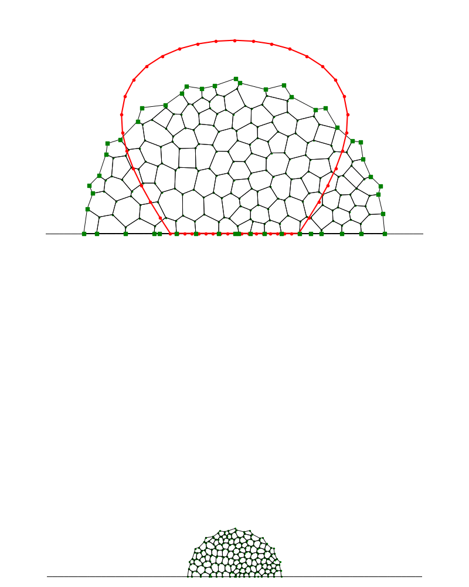

# diff-tissue

<p align="center">
  
</p>

## Differentiable Tissue Morphogenesis
This repository provides a differentiable vertex model for simulating and
optimizing plant tissue morphogenesis. It combines a vertex-based tissue model
with differentiable simulation. Keeping the simulation differentiable allows
model parameters and growth rules to be optimized or potentially learned from
data, enabling new workflows in computational biology and developmental
modeling.

The code accompanies:

> Skjegstad et al. (2026), *Differentiable Vertex Model: Exploring Gradient-Based
> Optimization for Tissue Morphogenesis*.

[bioRxiv preprint](https://doi.org/10.64898/2026.05.07.723189)

---

## Installation

### Prerequisites
This project uses **uv** for fast, modern dependency management. If you don't have it installed, you can get it via curl/PowerShell, or simply using pip:
```bash
pip install uv
```

### Setup Steps

1. **Clone the repository:**
   ```bash
   git clone https://github.com/larserik-js/diff-tissue.git
   cd diff-tissue
   ```

2. **Fetch and switch to your desired version (tag):**
   Ensure you have the latest list of versions from the remote server, then switch to the tag you want to run (replace `v1.0.0` with your target version):
   ```bash
   git fetch --all --tags
   git switch --detach v1.0.0
   ```
   *Note: This puts you in a "detached HEAD" state for read-only use. If you plan to make changes, create a new branch from this tag instead:*
   ```bash
   git switch -c my-new-branch v1.0.0
   ```

3. **Install dependencies:**
   Sync the project dependencies defined in `pyproject.toml` and `uv.lock`. This command automatically creates and configures your virtual environment (`.venv`) for this specific version:
   ```bash
   uv sync
   ```

---

## Usage

Run the main optimization pipeline:

```bash
uv run python scripts/run_shape_opt.py
```

This script runs three sequential steps. First, it performs the main simulation, optimizing cell-level parameters based on a tissue-level target boundary. By default, this target boundary is petal-shaped, the optimization runs for a maximum of 1000 steps, and it converges when the loss does not improve for 50 steps. After the simulation, two visualization steps generate the following outputs:

* Final optimized tissues for different optimization steps in `outputs/final_tissues/`
* Visualization of the best-loss morphogenesis process in `outputs/best_morph/`

Note that for a given set of parameters, the program caches intermediate simulation data in the `data/` folder. This means that if the program is rerun with the same parameters, the optimization step is skipped, and only the visualization steps are rerun (which produces the exact same outputs).

The script can also be run with custom parameters, for example:

```bash
uv run python scripts/run_shape_opt.py --shape trapezoid --id 1 --seed 10
```

Parameters:

* `--shape`: Target geometry
* `--id`: Regional cell identity configuration
* `--seed`: Random seed controlling mesh initialization

For a full list of parameters, see `src/diff_tissue/app/parameters.py`.

There are a few tests included for development purposes. They can be run with the `uv run pytest` command.

---

## Project Structure

```
diff_tissue/
├── scripts/          # Entry points and experiments
├── src/
│   └── diff_tissue/
│       ├── api/          # API-related code
│       ├── app/          # Application-level logic and configuration
│       └── core/         # Core simulation and modeling code
├── tests/            # Test functions
├── pyproject.toml    # Dependencies and project metadata
└── README.md
```

---

## License

This project is licensed under the MIT License.
